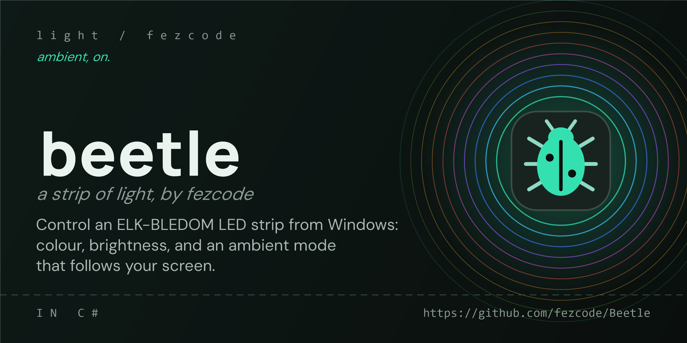
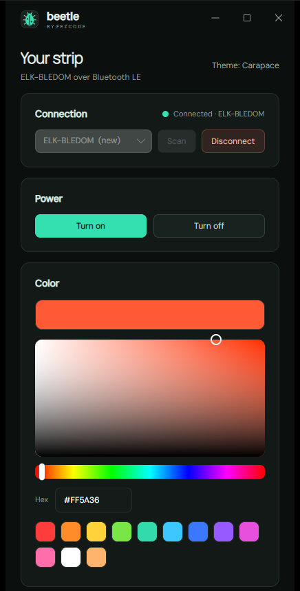
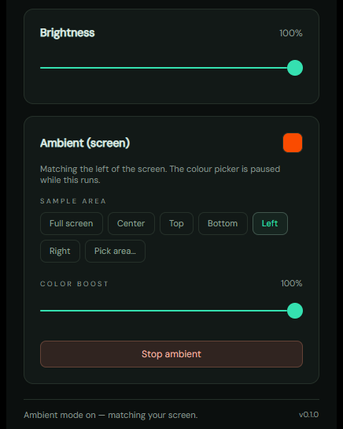
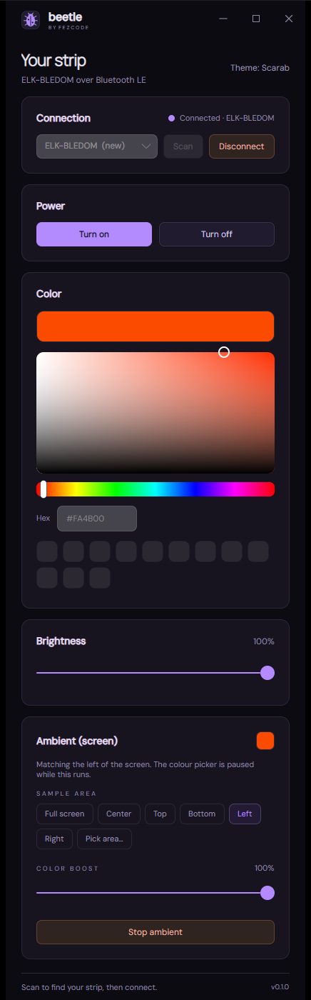

# Beetle

Control an ELK-BLEDOM Bluetooth LED strip from Windows. Turn it on and off, pick a colour,
set the brightness, and run an ambient mode that keeps the strip in tune with your screen.

Built with C# / .NET 10 / Avalonia 12, in the same code-first, dark-and-accented style as the
other Fezcode apps. No cloud, no account, no background service: just the app and your strip.

<p align="center">
  
  &nbsp;
  
</p>

## Features

- **Connect** to an ELK-BLEDOM strip over Bluetooth LE. The strip does not pair with Windows;
  Beetle finds it from its live advertisement and reconnects to it on launch.
- **Power** the strip on and off.
- **Colour**: a saturation/value square, a hue strip, a hex field and twelve presets. The colour
  streams to the strip as you drag.
- **Brightness**: the strip's hardware brightness, 0 to 100%.
- **Ambient mode**: samples your screen about 25 times a second and eases the strip toward its
  average colour.
  - **Color mode**: **Average** follows everything in the sample area. **Selective** first sets
    aside black, white and greys and follows only the colours that are left, so a red logo on a
    white page lights the strip red rather than a washed-out pink. With no colour on screen at all,
    the strip keeps its last colour.
  - **Sample area**: follow the full screen, the center, an edge, or drag out any area you like.
  - **Colour boost**: brightens and saturates colourful parts of the screen so a dark red reads as
    red on the strip, while dark greys and black stay dark.
- **Rainbow mode**: cycles the strip smoothly through every colour, from one trip every 60 seconds
  to one every 3, adjustable while it runs.
- **Music mode**: reacts to whatever your PC is playing (music, video, games; never the
  microphone). Loudness sets the brightness, flaring on each hit and fading quickly; each beat
  moves the colour round the wheel. Beetle adapts to the overall volume, so quiet and loud tracks
  both move the strip, and a Sensitivity slider sets how strongly it reacts. With nothing playing
  the strip settles to a dim glow.
  - **Beat colours**: pick colours from the swatches (or add the Color card's current colour) and
    each beat jumps to the next one in the order you picked them, holding it until the next beat.
    Red, white and blue, say, instead of the whole wheel. **All colours** goes back to the wheel.
- Ambient, rainbow and music mode take turns: starting one stops the others.
- **Lives in the tray.** Closing the window keeps Beetle running, ambient mode included. Click
  the tray icon to bring it back, or right-click it to turn the strip on or off, start or stop
  ambient, rainbow or music mode, or quit. Launching Beetle again shows the copy that is already running.
- **Two themes**, Carapace and Scarab. Beetle remembers your strip, colour, brightness, sample
  area, boost and theme.

<p align="center">
  
</p>

## Install

Run `Beetle-Setup-0.1.1.exe`, attached to the [GitHub releases](https://github.com/fezcode/Beetle/releases).
It installs per user, offers Desktop and Start Menu shortcuts, and keeps your settings when you
uninstall. Beetle is also listed in [Airlift](https://github.com/fezcode/Airlift).

Beetle runs on the [.NET 10 runtime](https://dotnet.microsoft.com/download/dotnet/10.0), which
the installer does not bundle. If it is missing, Windows offers to download it the first time
Beetle starts.

## Use

1. Power the strip and make sure its phone app is not connected to it: an ELK-BLEDOM stops
   advertising while anything is connected, which hides it from scans.
2. Open Beetle and press **Scan**, then **Connect**.
3. Use **Power**, **Color** and **Brightness**, or press **Start ambient**. The colour picker
   pauses while ambient mode runs.
4. Close the window when you are done with it; Beetle carries on from the tray. Choose
   **Quit Beetle** from the tray icon's menu to exit completely.

```
Beetle -v, --version       print the version
Beetle -h, --help          print help
```

Settings live in `%LOCALAPPDATA%\Fezcode\Beetle\settings.json`.

## Build

Requires the .NET 10 SDK on Windows.

```powershell
.\build.ps1 -Run              # build and launch
.\build.ps1 -Test             # build and run the tests
.\build.ps1 -Test -Publish    # tests, then a framework-dependent dist/win-x64/desktop
.\build-installer.ps1 -SkipBuild   # package dist/installer/Beetle-Setup-0.1.1.exe with Forge
.\version.ps1                 # check the version is consistent everywhere
```

The installer is built with Fezcode's Forge, expected at `../Forge/build/forge.exe`.
See [AGENTS.md](AGENTS.md) for the full release flow.

## How it works

- **Bluetooth.** `Beetle.Core` talks to the strip through Windows' built-in Bluetooth LE stack
  (the WinRT `Windows.Devices.Bluetooth` APIs). It writes to GATT characteristic `fff3` under
  service `fff0`, without response, which is the channel the strip expects.
- **Protocol.** Commands are the 9-byte ELK-BLEDOM frames, `7E ... EF`, in `LedCommands.cs`. The
  vendor publishes no protocol; these come from community reverse-engineering, so a frame that
  misbehaves on a particular unit is a one-line change there.
- **Ambient.** `GdiScreenSampler` shrinks the chosen area of the primary monitor to a 128x72 bitmap
  with a halftone (area-averaging) stretch and reduces it to one colour (`ColorAnalysis`): the plain
  average, or in selective mode the average of only the pixels with at least 25% saturation and 15%
  brightness. `AmbientController` applies the colour
  boost, eases the strip toward each sample, and sends a frame only when the colour has moved
  enough to be worth a write.
- **Music.** `LoopbackAudioSource` captures the default output device through WASAPI loopback (via
  NAudio) and feeds `MusicAnalyzer`, which measures loudness against a slowly fading peak and counts
  a beat when the bass (below about 150 Hz) jumps well above its recent average. `MusicController`
  turns that into brightness and hue about 30 times a second. The strip is a single zone, so it shows one colour at a time.

| Project | Contents |
|---|---|
| `Beetle.Core` | Colour maths, selective colour analysis, music analysis and audio capture, command frames, Bluetooth transport, screen sampler, controllers, settings. No UI dependency. |
| `Beetle.Desktop` | The Avalonia app: theme, UI helpers, window chrome, colour picker, area picker, tray icon, main window. |
| `Beetle.Tests` | xUnit tests for frame encoding, colour maths, boost, selective analysis, music analysis, rainbow, sample areas and controller behaviour. |

## Limits

- Windows only. Avalonia is cross-platform; Bluetooth and the screen grab are not.
- Ambient mode samples the primary monitor.
- Brightness is sent as 0 to 100. Some ELK-BLEDOM variants expect another scale; if yours ignores
  it, adjust `LedCommands.Brightness`.

## License

[MIT](LICENSE.txt). The bundled fonts, DM Sans and Manrope, keep their own SIL Open Font Licenses.
[NAudio](https://github.com/naudio/NAudio) is used under the MIT License.
